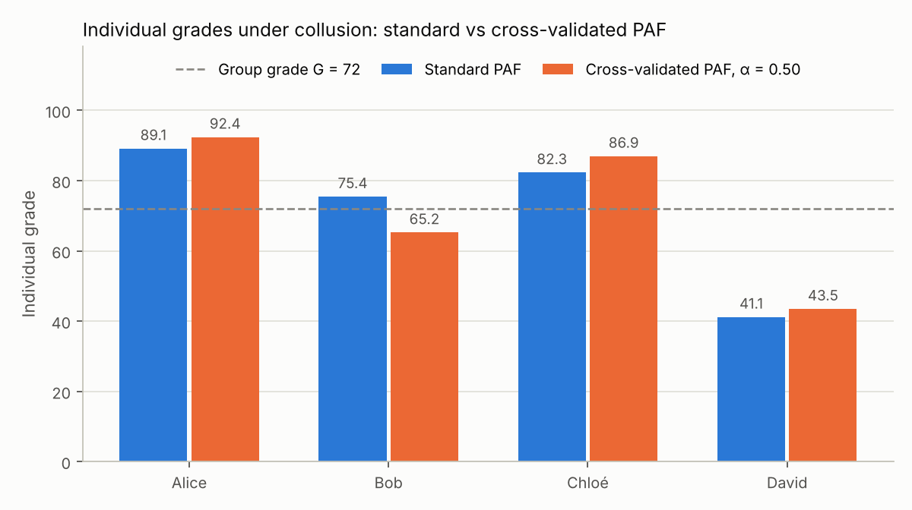
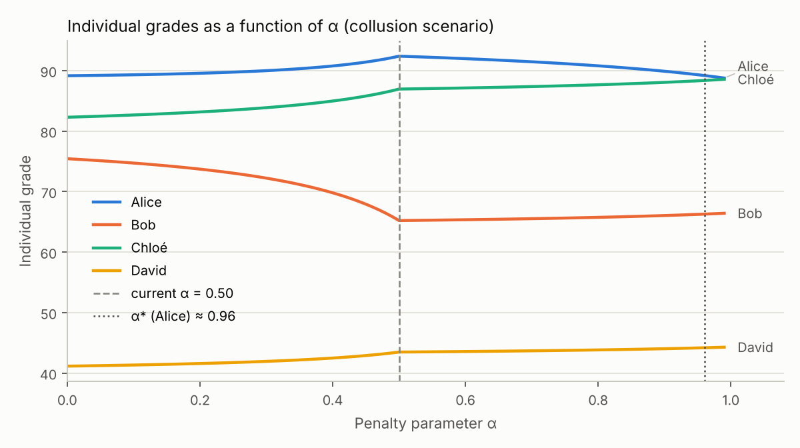
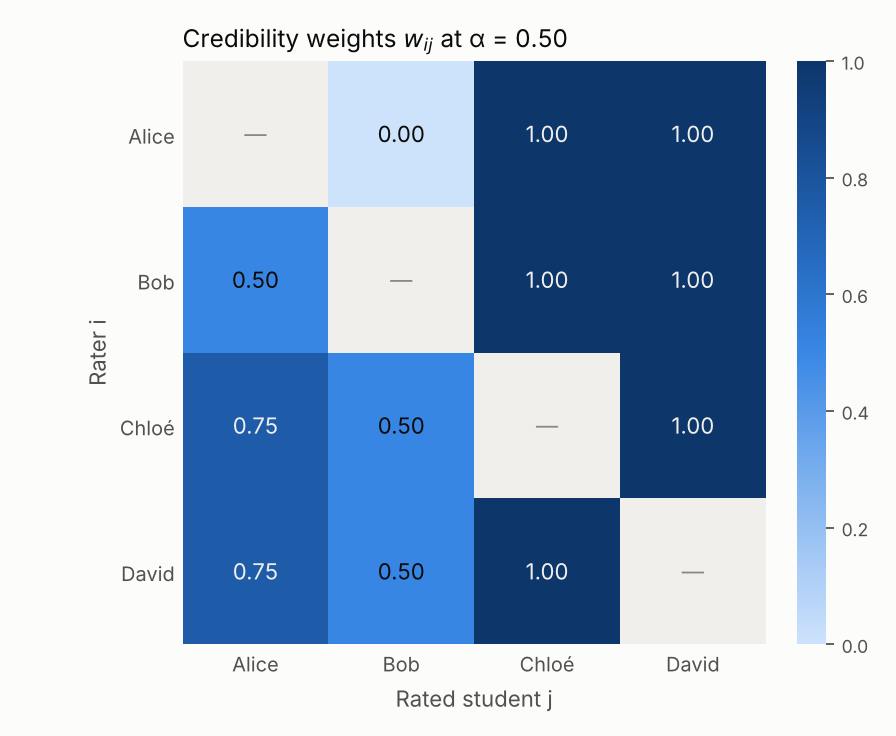

# Cross-validated peer assessment: a collusion-resistant mechanism for group work

**Under What Conditions Does a Cross-Validated Peer Assessment Mechanism Induce Truthful Reporting and Eliminate Free-Riding in Student Group Work?**

John Headley · BSc Economics Project (EC3009), City, University of London · May 2026

[](tests/test_paf_mechanism.py) [](LICENSE)

This repository contains the Python implementation of the mechanism developed in the paper ([`paper/`](paper/Cross-Validated_Peer_Assessment_EC3009.pdf)), a test suite that reproduces the paper's worked example number for number, an interactive simulation notebook, and the companion lab-experiment proposal ([`docs/`](docs/Experimental_Design_Moral_Wiggle_Room.pdf)).

## Abstract

In a shared-reward production configuration that includes groups producing in higher education, the free-riding incentive is a major challenge. Institutional design, such as peer assessment review, seeks to mitigate this phenomenon. The main limitation of mechanisms such as the peer assessment factor is its sensitivity to collusion, especially reciprocal inflation, which effectively reduces the accuracy of such mechanisms. This project addresses this challenge by extending the peer assessment factor using a cross-validation methodology. The peer assessment factor uses consensus on a student's contribution as a reference point to evaluate the honesty of each rating and, from this, weights the credibility of each rating. The goal is to detect reciprocal inflation and adjust the credibility weight of each rating to reduce the effectiveness of collusion. This project uses mainstream peer assessment to make implementing such a solution feasible. Using numerical and Python simulations, this project proposes a cross-validated version of the peer assessment that makes reciprocal inflation less profitable while preserving a balanced budget.

## Research question

Under what conditions does a cross-validated peer assessment mechanism induce truthful reporting and eliminate free-riding in student group work?

Group work is a team-production problem: the grade $G$ is shared but effort is costly and individual, so each student equates marginal cost to only $1/n$ of the marginal social benefit and under-contributes (Holmström, 1982). Peer assessment factors (PAF) make the grade individual, but shift the problem from free-riding to honest reporting: friends can inflate each other's ratings. The paper asks whether weighting each rating by its credibility — its distance from the consensus of the other peers — restores truthful reporting while keeping the mechanism budget balanced and institutionally tractable.

## The mechanism

$n$ students receive a common group grade $G$. Each student $i$ rates every peer $j \neq i$ on a 1–5 scale, $r_{ij}$; students do not rate themselves. Let $\theta_j$ be the true (privately observable) contribution of $j$.

**Standard PAF.** With $R_j = \frac{1}{n-1}\sum_{i \neq j} r_{ij}$ the average rating received by $j$ and $\bar{R} = \frac{1}{n}\sum_j R_j$ the group average,

$$G_j = G \times \frac{R_j}{\bar{R}}$$

**Cross-validated PAF.** Each rating is compared with the consensus of the other raters and discounted according to its deviation, with a penalty parameter $\alpha \geq 0$:

$$C_{ij} = \frac{1}{n-2}\sum_{\substack{k=1 \\ k \neq i,\, k \neq j}}^{n} r_{kj} \qquad\text{(consensus about } j \text{, excluding } i\text{)}$$

$$d_{ij} = r_{ij} - C_{ij} \qquad\text{(deviation from consensus)}$$

$$w_{ij} = \max\left(0,\; 1 - \alpha \cdot \lvert d_{ij} \rvert\right) \qquad\text{(credibility weight)}$$

$$R_j^{w} = \frac{\sum_{i \neq j} w_{ij}\, r_{ij}}{\sum_{i \neq j} w_{ij}}, \qquad \bar{R}^{w} = \frac{1}{n}\sum_{j=1}^{n} R_j^{w}, \qquad PAF_j^{w} = \frac{R_j^{w}}{\bar{R}^{w}}, \qquad G_j = G \times PAF_j^{w}$$

With $\alpha = 0$ every weight is one and the mechanism is the standard PAF. If all weights received by a student are zero, the plain mean of that student's ratings is used (Appendix II of the paper).

## Propositions

1. **The standard PAF is not collusion-proof.** A coalition of two or more students can inflate each other's grades at the expense of honest students (Proposition 1; worked out in Appendix I).
2. **Truthful reporting is a weak Nash equilibrium under unilateral deviation for $\alpha \geq \alpha^{\ast}$.** If one rater inflates a report by $\delta$ while everyone else is honest, the consensus equals $\theta_j$, the deviation equals $\delta$ and the dishonest report gets weight $\max(0, 1 - \alpha\lvert\delta\rvert)$, which is zero as soon as

$$\alpha \geq \alpha^{\ast} = \frac{1}{\lvert \delta \rvert}$$

   The report is neutralised but the liar's own grade is not reduced (it depends on the other, honest, ratings), hence a *weak* equilibrium. Large lies are neutralised at low $\alpha$ ($\lvert\delta\rvert = 2 \Rightarrow \alpha^{\ast} = 0.5$); a lie of one unit needs $\alpha^{\ast} = 1$. The result does not extend to simultaneous multi-rater collusion, where the consensus itself is corrupted (Proposition 2, Section 4.1).
3. **Budget balance holds by construction.** Since $\sum_j PAF_j^{w} = n$,

$$\sum_{j=1}^{n} G_j = n \times G$$

   The mechanism only redistributes the points the teacher awarded; it never creates or destroys marks (Proposition 3).

## Worked example (Table 4 of the paper)

Four students — Alice, Bob, Chloé and David — with true efforts $(4, 3, 4, 2)$ and $G = 72$. David is a free rider. Alice inflates her rating of Bob from 3 to 5 ($\delta_{AB} = 2$) and Bob inflates his rating of Alice from 4 to 5 ($\delta_{BA} = 1$).

| Student | Standard PAF, honest | Standard PAF, collusion | Cross-validated, α = 0.5 | Cross-validated, α = 0.99 |
|---|---|---|---|---|
| Alice | 88.6 | 89.1 | **92.4** | 88.8 |
| Bob | 66.5 | 75.4 [^1] | **65.2** | 66.4 |
| Chloé | 88.6 | 82.3 | 86.9 | 88.5 [^1] |
| David | 44.3 | 41.1 | 43.5 | 44.3 |
| Sum | 288 | 288 | 288 | 288 |

Every column sums to $4 \times 72 = 288$. Under the standard PAF the collusion pays, and the bigger lie pays the bigger return: Bob (inflated by $\delta = 2$) gains far more than Alice (inflated by $\delta = 1$), while Chloé and David lose 6.3 and 3.2 points. At $\alpha = 0.5$ the larger lie is fully discounted ($w_{AB} = 0$) but the smaller one only half ($w_{BA} = 0.5$): Alice gains +3.8 but Bob *loses* 1.3 relative to his honest grade. At $\alpha = 0.99$ all four students are back within 0.2 of their honest grades and the coalition's joint gain collapses to about +0.1. ($\alpha = 0.99$ stands in for the limit $\alpha \to 1^{-}$: at $\alpha = 1$ exactly, the corrupted consensus would also discount Chloé's and David's honest ratings of Bob to zero.)

[^1]: The paper's Table 4 / Appendix I prints 77.5 for Bob under the standard PAF with collusion and 88.6 for Chloé at α = 0.99. The step-by-step calculations of Appendix I give $72 \times 3.67 / 3.50 = 75.4$ (with 77.5 the column would sum to 290, not 288) and $72 \times 4 / 3.2525 = 88.5$; the code and the tests use these values.

## Three economic findings (Section 4.2)

1. **Coalition internal instability.** At $\alpha = 0.5$ the larger lie is fully discounted but the smaller one is not: Alice gains, Bob loses. Without side payments or social ties the coalition is not stable — Bob would refuse to take part if he knew the result.
2. **The bigger liar is punished first.** Larger deviations cross the zero-weight threshold at lower $\alpha$; as $\alpha$ rises from 0 the mechanism neutralises the largest lie first.
3. **Mechanism stability ceiling.** At $\alpha = 1/\lvert\delta_{\min}\rvert$ the honest raters' weights also collapse, because the corrupted consensus places them one unit away from the apparent consensus. A practical implementation needs $\alpha$ strictly below $1/\lvert\delta_{\min}\rvert$.

The paper concludes that the mechanism induces truthful reporting and eliminates free-riding when (i) $\alpha \geq \alpha^{\ast}$, (ii) the group size satisfies $n \geq 4$, and (iii) effort is mutually observable, so that the consensus $C_{ij}$ is meaningful.

## Simulation

[`notebooks/simulation.ipynb`](notebooks/simulation.ipynb) calls the mechanism with an `ipywidgets` slider for $\alpha \in [0, 1]$ and a numeric input for $G$, and draws three figures (shown here at $\alpha = 0.5$, $G = 72$).

**Grades under the standard PAF versus the cross-validated PAF at α = 0.5**, with the group grade as a dashed reference line. Bob's inflated grade disappears once Alice's rating of him is discounted.



**Each student's grade as a function of α.** Bob's grade falls and Chloé's rises as α increases; the dashed line marks the current α = 0.5 and the dotted line α\* (Alice) ≈ 0.96 as in Figure 5 of the paper.



**Credibility weights $w_{ij}$ at α = 0.5** (rows: raters, columns: rated). Alice's rating of Bob gets weight 0, Bob's rating of Alice weight 0.5; all ratings of Chloé and David keep weight 1.



## How to run

```bash
pip install -r requirements.txt
pytest                      # reproduces Table 4 / Appendix I of the paper
jupyter notebook notebooks/simulation.ipynb
```

```python
import paf_mechanism as paf

paf.standard_grades(paf.EXAMPLE_COLLUSION, G=72)             # [89.1, 75.4, 82.3, 41.1]
paf.cross_validated_grades(paf.EXAMPLE_COLLUSION, G=72, alpha=0.5)  # [92.4, 65.2, 86.9, 43.5]
paf.credibility_weights(paf.EXAMPLE_COLLUSION, alpha=0.5)    # w_ij matrix (NaN diagonal)
paf.alpha_star(delta=2)                                       # 0.5
```

`paf_mechanism.py` exposes the standard PAF (`standard_paf`, `standard_grades`), the cross-validated mechanism (`consensus`, `deviations`, `credibility_weights`, `weighted_ratings`, `cross_validated_paf`, `cross_validated_grades`), the threshold `alpha_star` and a budget-balance check `is_budget_balanced`. The rating matrices of the worked example are included as `EXAMPLE_HONEST` and `EXAMPLE_COLLUSION`.

## Companion: proposed lab experiment

[`docs/Experimental_Design_Moral_Wiggle_Room.pdf`](docs/Experimental_Design_Moral_Wiggle_Room.pdf) is an experimental-economics proposal that would test the mechanism in the lab: *does reducing moral wiggle room through objective cross-validation decrease the strategic deflation of peer ratings in one-shot group assessments?* It is a between-subjects design with 120 subjects (60 per condition) in groups of four, randomly assigned at the session level. Subjects perform a real-effort task — counting zeros in 10×10 binary matrices for five minutes — which yields an objective score $\theta_j$ as ground truth, then rate their three peers on a 1–5 scale. In the baseline condition the group's points are redistributed with the standard PAF; in the treatment condition with the cross-validated PAF (weights $w_{ij} = \max(0, 1 - \alpha\lvert r_{ij} - C_{ij}\rvert)$, with $\alpha$ calibrated in a pilot). Decisions are paid in real money. The outcome is the strategic deflation rate — the gap between a subject's rating of a peer and that peer's objective count — which is predicted to be lower under cross-validation (Dana, Weber & Kuang, 2007; Kandel & Lazear, 1992). The proposal contains no data or code.

## References

- Alchian, A. A. and Demsetz, H. (1972), "Production, Information Costs, and Economic Organization", *American Economic Review*, 62(5), 777–795.
- Alon, N., Fischer, F., Procaccia, A. and Tennenholtz, M. (2011), "Sum of Us: Strategyproof Selection from the Selectors", *Proceedings of TARK XIII*, 101–110.
- Bandiera, O., Barankay, I. and Rasul, I. (2010), "Social Incentives in the Workplace", *Review of Economic Studies*, 77(2), 417–458.
- Brooks, C. M. and Ammons, J. L. (2003), "Free Riding in Group Projects and the Effects of Timing, Frequency, and Specificity of Criteria in Peer Assessments", *Journal of Education for Business*, 78(5), 268–272.
- Carpenter, J. (2007), "Punishing Free-Riders: How Group Size Affects Mutual Monitoring and the Provision of Public Goods", *Games and Economic Behavior*, 60(1), 31–51.
- Dana, J., Weber, R. A. and Kuang, J. X. (2007), exploiting moral wiggle room in a modified dictator game (cited in the experimental proposal).
- de Clippel, G., Moulin, H. and Tideman, N. (2008), "Impartial Division of a Dollar", *Journal of Economic Theory*, 139(1), 176–191.
- Falkinger, J. (1996), "Efficient Private Provision of Public Goods by Rewarding Deviations from Average", *Journal of Public Economics*, 62(3), 413–422.
- Faltings, B. and Radanovic, G. (2017), *Game Theory for Data Science: Eliciting Truthful Information*, Morgan & Claypool.
- Holmström, B. (1982), "Moral Hazard in Teams", *Bell Journal of Economics*, 13(2), 324–340.
- Kandel, E. and Lazear, E. P. (1992), "Peer Pressure and Partnerships", *Journal of Political Economy*, 100(4), 801–817.
- Li, B. and Du, X. (2025), "A Strategy-Proof and Collusion-Proof Peer Grading Mechanism", in *Mechanism Design in Social Networks (MNet 2024 Proceedings)*, CCIS 2210, Springer, 86–94.
- Magin, D. (2001), "Reciprocity as a Source of Bias in Multiple Peer Assessment of Group Work", *Studies in Higher Education*, 26(1), 53–63.
- Olson, M. (1965), *The Logic of Collective Action*, Harvard University Press.
- Topping, K. (1998), "Peer Assessment Between Students in Colleges and Universities", *Review of Educational Research*, 68(3), 249–276.
- Witkowski, J. and Parkes, D. C. (2012), "Peer Prediction Without a Common Prior", *Proceedings of the 13th ACM Conference on Electronic Commerce (EC '12)*, 964–981.

## Author

John Headley — BSc Economics Project (EC3009), City, University of London, May 2026.

The code in this repository is released under the MIT License ([`LICENSE`](LICENSE)); the paper and the experimental proposal are included for reference and remain the author's copyright.
